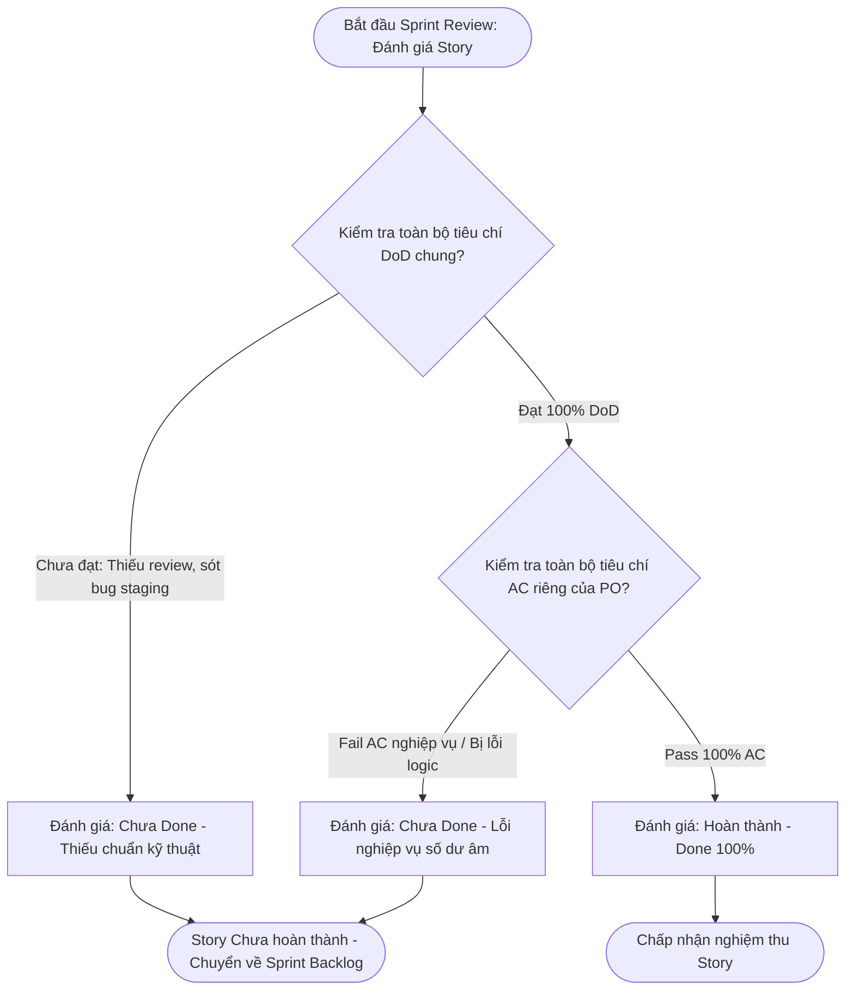

# BÁO CÁO PHÂN TÍCH VÀ PHÂN ĐỊNH ACCEPTANCE CRITERIA (AC) VÀ DEFINITION OF DONE (DoD) CHO CHỨC NĂNG THANH TOÁN VÍ RIKKEIPAY

> 👤 **Học viên:** Đỗ Hoàng Sơn | **Mã SV:** PTIT-HCM-066
> 🏫 **Môn học:** IT206-K25-Agile-va-Scrum

---

## 📊 Sơ đồ thiết kế hệ thống (Flowchart)

> 💡 *Sơ đồ dưới đây được render tự động trực tiếp trên GitHub bằng Mermaid. Bạn cũng có thể tải file **`bt2.drawio`** trong repository này để mở và chỉnh sửa trực tiếp trên [Draw.io (diagrams.net)](https://app.diagrams.net).* 

---

## Phần 1 - Phân tích: Bảng phân loại và đánh giá tiêu chí hoàn thành (Đ1 - Đ5)

Trong vai trò Scrum Master (Lan), việc hợp nhất nhầm lẫn giữa Acceptance Criteria (AC) và Definition of Done (DoD) của Developer Khoa là nguyên nhân trực tiếp dẫn tới nhận định sai lệch về trạng thái hoàn thành của Story tại buổi Sprint Review.

AC là tiêu chí chấp nhận riêng biệt cho từng User Story cụ thể do Product Owner chịu trách nhiệm định nghĩa để kiểm tra tính đúng đắn về mặt nghiệp vụ. Ngược lại, DoD là định nghĩa hoàn thành chung do Developers thiết lập, đóng vai trò là hàng rào kiểm soát chất lượng kỹ thuật áp dụng xuyên suốt cho tất cả các User Story mà không chỉnh sửa riêng lẻ.

| Phát biểu | Phân loại (AC / DoD) | Trạng thái | Lý do phân tích chi tiết |
| --- | --- | --- | --- |
| Đ1. Given số dư ví đủ trả cước, When khách xác nhận thanh toán, Then chuyến chuyển sang 'Đã thanh toán' và ví bị trừ đúng số tiền cước. | AC | Đạt | Bản chất: Thuộc AC vì mô tả kịch bản nghiệp vụ luồng thành công (Happy Case) riêng biệt của tính năng thanh toán ví RikkeiPay, cấu trúc chuẩn cú pháp Given - When - Then. Trạng thái: Đạt vì hệ thống đã thực thi đúng kịch bản khi tài khoản đủ tiền. |
| Đ2. Code được ít nhất 01 Developer khác review trước khi merge. | DoD | Đạt | Bản chất: Thuộc DoD vì đây là quy chuẩn kiểm soát chất lượng kỹ thuật (Peer Code Review) áp dụng chung cho mọi Story/Pull Request trong nhóm phát triển, không phải logic nghiệp vụ riêng của thanh toán. Trạng thái: Đạt theo báo cáo của Developer Khoa trước khi merge. |
| Đ3. Thanh toán bằng ví phải nhanh, mượt, khách dùng thấy thích. | AC (Phi chức năng) | Chưa đạt | Bản chất: Thuộc nhóm yêu cầu phi chức năng (Non-functional Requirement) gắn với trải nghiệm thanh toán ví của Story này. Tuy nhiên, tiêu chí này mang tính cảm tính, định tính ('nhanh, mượt, thấy thích'), không thể đo lường hay kiểm chứng được bằng kịch bản kiểm thử (Test Case). |
| Đ4. Given số dư ví không đủ trả cước, When khách xác nhận thanh toán, Then hệ thống hiển thị 'Số dư không đủ' và chuyến vẫn ở trạng thái 'Chưa thanh toán'. | AC | Chưa đạt | Bản chất: Thuộc AC vì mô tả kịch bản kiểm thử biên/ngoại lệ (Edge Case / Error Handling) riêng của chức năng thanh toán ví. Trạng thái: Chưa đạt vì khi PO Đức kiểm tra thực tế, số dư không đủ nhưng hệ thống vẫn trừ tiền, vi phạm nghiêm trọng tính toàn vẹn dữ liệu tài chính. |
| Đ5. Story thanh toán ví đã chạy trên staging (môi trường thử nghiệm) và không còn lỗi nghiêm trọng (Blocker/Critical). | DoD (Bị gán sai phạm vi) | Chưa đạt | Bản chất: Việc triển khai trên môi trường staging và không tồn đọng lỗi Blocker/Critical là tiêu chuẩn nghiệm thu chất lượng kỹ thuật chung (DoD), nhưng Khoa đã sai khi thu hẹp phạm vi chỉ gán cho riêng 'Story thanh toán ví'. Trạng thái: Chưa đạt vì lỗi trừ tiền khi số dư không đủ phát hiện bởi PO là lỗi nghiêm trọng (Critical/Blocker) về tài chính đang tồn tại trên staging. |

## Phần 2 - Vá lỗi: Chuẩn hóa tiêu chí kiểm chứng và Kết luận trạng thái Story

Để đảm bảo tính minh bạch và khả năng kiểm thử theo chuẩn Agile/Scrum, các phát biểu cảm tính và sai lệch phạm vi được chuẩn hóa lại như sau:

- Viết lại Đ3 thành AC kiểm chứng được (Performance & Usability Criteria): 'Given khách hàng bấm xác nhận thanh toán bằng ví RikkeiPay với kết nối mạng ổn định, When hệ thống xử lý giao dịch, Then thời gian phản hồi và hiển thị kết quả không quá 2 giây, và tỷ lệ thành công của thao tác đạt tối thiểu 99% trong điều kiện tải tiêu chuẩn.'
- Viết lại Đ5 thành tiêu chí DoD chung (Áp dụng toàn bộ Product Backlog): 'Mọi User Story phải được triển khai và kiểm thử thành công trên môi trường Staging, không còn bất kỳ lỗi nào ở mức độ Blocker hoặc Critical mở (Open Defects) trước khi đưa ra Sprint Review.'

## Kết luận về trạng thái Story và Hướng xử lý tiếp theo

Kết luận trạng thái: Story 'Thanh toán bằng ví RikkeiPay' CHƯA HOÀN THÀNH (Not Done) do vi phạm cả AC (thất bại kịch bản Đ4 khi số dư không đủ vẫn trừ tiền) lẫn DoD (tồn đọng lỗi Critical về mặt tài chính trên môi trường staging).

Hướng xử lý tiếp theo: Story không được phép nghiệm thu hay phát hành trong Sprint này mà phải chuyển ngược lại Sprint Backlog; Developers phải ghi nhận bug nghiêm trọng về logic trừ tiền, tiến hành sửa lỗi, cập nhật unit test và chạy lại kiểm thử hồi quy để PO đánh giá lại vào Sprint tiếp theo.

---

## 📁 Danh sách tệp tin nộp bài trong Repository
- 📝 `bt2.docx`: Báo cáo tài liệu phân tích nghiệp vụ hoàn chỉnh.
- 🎨 `bt2.drawio`: File thiết kế sơ đồ chuẩn theo quy định đề bài (mở trực tiếp bằng [Draw.io](https://app.diagrams.net) hoặc Lucidchart).
